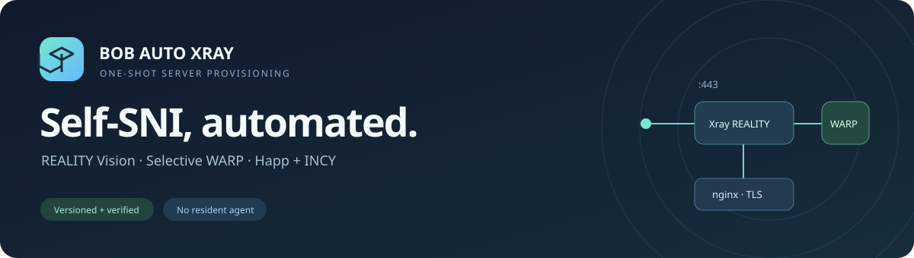
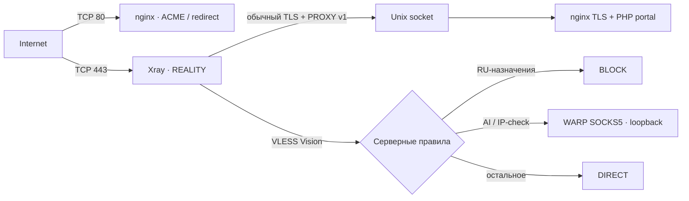

<p align="center"></p>

<p align="center">
  <a href="https://github.com/DaMistic727/Bob-auto-xray/actions/workflows/ci.yml"></a>
  <a href="https://github.com/DaMistic727/Bob-auto-xray/releases"></a>
  <a href="LICENSE"></a>
  
</p>

# Bob Auto Xray

**Чистая VPS → готовый VLESS TCP REALITY Vision с собственным SNI.**

Одноразовый установщик разворачивает 3x-ui, HTTPS-заглушку частного облака, выборочную маршрутизацию через WARP и подписки для Happ/INCY. Конфигурации создаются автоматически, клиентов вы добавляете через панель.

> **Статус: initial preview.** Полный запуск, внешний Vision-клиент и реальная перезагрузка проверены на Ubuntu 24.04 amd64 с существующим WARP. Другие ОС/архитектуры и мобильные приложения пока не прошли отдельные e2e-тесты. [Подробный отчёт →](docs/TESTING.md)

## Что получится

| Компонент | Результат |
|---|---|
| **3x-ui** | HTTPS, случайный порт и путь, уникальные credentials |
| **REALITY** | TCP/443, Self-SNI, Vision, Unix socket nginx, PROXY protocol v1 |
| **Заглушка** | Уникальный облачный login portal, PHP-FPM, CSRF; данные формы не сохраняются |
| **TLS** | Certbot HTTP-01 webroot, автоматическое продление для всех TLS-сервисов |
| **WARP** | SOCKS5 только на loopback; AI/IP-check через WARP, остальное DIRECT |
| **Маршрутизация** | RU-назначения блокируются на сервере; входящие клиенты географически не фильтруются |
| **Happ / INCY** | Отдельные профили и способы доставки; правила из [DigneZzZ/routing](https://github.com/DigneZzZ/routing) |
| **Защита** | UFW с сохранением SSH, штатная интеграция Fail2ban 3x-ui |

## Быстрый старт

1. **Создайте DNS A-запись** своего FQDN на IPv4 VPS, без CDN proxy. Если IPv6 не настроен, удалите AAAA.
2. **Подготовьте чистую VPS** с root-доступом и открытыми у провайдера TCP/80 и TCP/443. Проверенная ОС — Ubuntu 24.04 amd64; официальный пакет WARP должен существовать для выбранной платформы.
3. **Запустите установщик одной командой** от root:

   ```bash
   bash <(curl --fail --silent --show-error --location --proto '=https' --proto-redir '=https' https://github.com/DaMistic727/Bob-auto-xray/releases/download/v0.1.0/install.sh)
   ```

   Он запросит FQDN и необязательный email Let's Encrypt. Bootstrap загружает **конкретный релиз** и проверяет закреплённый SHA256 архива до выполнения модулей. [Модель доверия и ручная проверка →](docs/RELEASE.md)

4. **Сохраните HTTPS-ссылку, логин и пароль**, которые появятся после успешных проверок. На VPS результат хранится в root-only `/var/lib/selfsni/state.json`.
5. **Добавляйте клиентов через 3x-ui**, привязывая их к созданному inbound и выбирая flow `xtls-rprx-vision`. Подписки и клиентская маршрутизация уже настроены.

<details>
<summary>Уже установлен WARP / нужен non-interactive запуск?</summary>

Скопируйте и распакуйте проверенный release archive, затем:

```bash
bash /root/selfsni/install.sh --domain vpn.example.com --adopt-warp
```

`--adopt-warp` явно разрешает использовать совместимый существующий WARP. Регистрация и режим не меняются; обязательны proxy mode, loopback listener и рабочий trace. Существующий VPS-Server-Menu принимается только на закреплённом commit без изменений содержимого файлов. Без этого флага обнаруженная установка WARP вызывает отказ.

Параметры: `--domain`, `--email`, `--ssh-port`, `--adopt-warp`, `--preflight-only`. На частично установленной или чужой конфигурации повторная установка по умолчанию запрещена.

</details>

## Как устроен трафик



Клиентские профили Happ/INCY направляют российские и локальные ресурсы напрямую с устройства. Серверная RU-блокировка служит дополнительной защитой, если такой трафик всё-таки попадёт в туннель. Полный состав и приоритеты — в [описании архитектуры](docs/ARCHITECTURE.md).

## Поддержка и проверки

| Платформа / сценарий | Статус |
|---|---|
| Ubuntu 24.04 amd64 + существующий WARP | Проверены установка, внешний клиент и reboot |
| Ubuntu 22.04 / 26.04; arm64 | Предусмотрены в коде; отдельное развёртывание не проверено |
| Новая установка WARP | Реализована; отдельная чистая VPS ещё нужна для e2e |
| Happ / INCY | Проверены реальные HTTP-ответы, Base64/JSON и deeplink |
| Мобильные приложения | Импорт и работа на устройствах пока не проверены |

CI выполняет статические проверки, unit/bootstrap-тесты и воспроизводимую сборку. Он **не заменяет** развёртывание на VPS. Подробные подтверждения: [тестирование](docs/TESTING.md), [после reboot](docs/onhost-after-reboot.json), [внешний клиент](docs/external-acceptance.json).

## Документация и участие

- [Архитектура, маршрутизация и безопасность](docs/ARCHITECTURE.md)
- [Релизы, SHA256 и установка из исходников](docs/RELEASE.md)
- [Версии и контрольные суммы upstream](versions.lock.json)
- [Изменения](CHANGELOG.md) · [Планы](docs/ROADMAP.md)
- [Как предложить изменение](CONTRIBUTING.md) · [Сообщить об уязвимости](SECURITY.md)

Проект использует официальные [3x-ui](https://github.com/MHSanaei/3x-ui), [VPS-Server-Menu](https://github.com/Diman6267/VPS-Server-Menu) и [DigneZzZ/routing](https://github.com/DigneZzZ/routing). [Атрибуция и лицензии зависимостей →](THIRD_PARTY_NOTICES.md)

Код проекта распространяется под [GPL-3.0](LICENSE). Данные и материалы третьих сторон сохраняют условия своих правообладателей.
