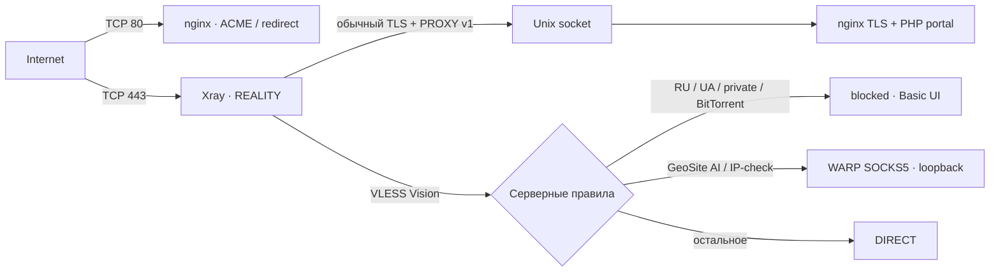

<p align="center"></p>

<p align="center">
  <a href="https://github.com/DaMistic727/Bob-auto-xray/actions/workflows/ci.yml"></a>
  <a href="https://github.com/DaMistic727/Bob-auto-xray/releases"></a>
  <a href="LICENSE"></a>
  
</p>

# Bob Auto Xray

**Чистая VPS → готовый VLESS TCP REALITY Vision с собственным SNI.**

Одноразовый установщик разворачивает 3x-ui, HTTPS-заглушку частного облака, выборочную маршрутизацию через WARP и подписки для Happ/INCY. Конфигурации создаются автоматически, клиентов вы добавляете через панель.

> **Статус: preview.** Исправление BBR preflight для минимальных образов без `modinfo` выпущено в v0.3.3. Кандидат из PR #6 прошёл clean install на Ubuntu 26.04.1 LTS amd64, новую регистрацию WARP, BBR/FQ, native Geodata Auto-Update, Target UI, Firefox/REALITY Vision, внешний клиент и реальную перезагрузку. Этот E2E выполнен на кандидате PR #6, а не на опубликованном архиве v0.3.3. Happ и INCY проверены пользователем на физическом iPhone. [Подробный отчёт →](docs/TESTING.md)

> **v0.3.4 ещё не опубликован и сейчас блокирует установку до изменения upstream.** Официальный `Diman6267/VPS-Server-Menu` `main` не предоставляет безопасного неинтерактивного интерфейса установки WARP: штатная функция добавляет cron и при сбое может ожидать ввод. Установщик меню также может сбросить существующий checkout и изменить `.bashrc`. Bob проверяет официальный commit до системных изменений и останавливается с диагностикой. До нового VPS E2E используйте опубликованный v0.3.3; его поведение отличается от текущего кандидата.

## Что получится

| Компонент | Результат |
|---|---|
| **3x-ui** | HTTPS, случайный порт и путь, уникальные credentials |
| **REALITY** | TCP/443, Self-SNI, Vision, Unix socket nginx, PROXY protocol v1 |
| **Заглушка** | Уникальный облачный login portal, PHP-FPM, CSRF; данные формы не сохраняются |
| **TLS** | Certbot HTTP-01 webroot, автоматическое продление для всех TLS-сервисов |
| **WARP** | SOCKS5 только на loopback; компактные GeoSite AI/IP-check через WARP |
| **Маршрутизация** | Basic UI `blocked`, RU/UA/private/BitTorrent блокируются; `IPOnDemand`, остальное DIRECT |
| **Geodata** | Штатный Xray hot reload четырёх файлов ежедневно в 03:00 МСК через `direct`, с rollback |
| **TCP BBR** | Автоматически настраивается на поддерживаемом ядре Linux, с FQ pacing и сохранением после reboot |
| **Happ / INCY** | Отдельные профили и способы доставки; правила из [DigneZzZ/routing](https://github.com/DigneZzZ/routing) |
| **Защита** | UFW с сохранением SSH, штатная интеграция Fail2ban 3x-ui |

## Быстрый старт

1. **Создайте DNS A-запись** своего FQDN на IPv4 VPS, без CDN proxy. Если IPv6 не настроен, удалите AAAA.
2. **Подготовьте чистую VPS** с root-доступом и открытыми у провайдера TCP/80 и TCP/443. Проверенная ОС — Ubuntu 26.04 amd64; установщик использует официальный WARP-пакет именно для codename VPS.
3. **Запустите установщик одной командой** от root:

   ```bash
   bash <(curl --fail --silent --show-error --location --proto '=https' --proto-redir '=https' https://github.com/DaMistic727/Bob-auto-xray/releases/download/v0.3.3/install.sh)
   ```

   Опубликованный v0.3.3 запускает мастер и показывает сводку перед изменениями. Кандидат v0.3.4 использует понятные вопросы о домене и сертификате, показывает живой статус длительных операций и объясняет ошибки Certbot. Bootstrap загружает **конкретный релиз** и проверяет закреплённый SHA256 архива до выполнения модулей.

4. **Сохраните HTTPS-ссылку, логин и пароль**, которые появятся после успешных проверок. На VPS результат хранится в root-only `/var/lib/selfsni/state.json`.
5. **Добавляйте клиентов через 3x-ui**, привязывая их к созданному inbound и выбирая flow `xtls-rprx-vision`. Подписки и клиентская маршрутизация уже настроены.

<details>
<summary>Уже установлен WARP / нужен non-interactive запуск?</summary>

Скопируйте и распакуйте проверенный release archive, затем:

```bash
bash /root/selfsni/install.sh --domain vpn.example.com --adopt-warp
```

`--adopt-warp` предназначен для совместимого существующего WARP. В текущем кандидате v0.3.4 установка и продолжение останавливаются до изменения системы: официальный `main` меню пока не имеет безопасного интерфейса автоматизации. Успешный WARP health на VPS относится к предыдущему кандидату с форком, а не к этому коду.

Параметры: `--domain`, `--email`, `--ssh-port`, `--adopt-warp`, `--preflight-only`. При non-interactive запуске `--domain` обязателен. `NO_COLOR=1` отключает ANSI-цвета. `--preflight-only` строго read-only.

Кандидат v0.3.4 хранит этап и installation ID в root-only state. После доказанного сбоя `APT_UPDATE`, `APT_UPGRADE`, `APT_INSTALL`, `WARP` или выдачи сертификата повтор той же команды продолжает установку, сохраняя порты и credentials. Если домен уже сохранён, мастер не спрашивает его снова. Перед повтором Certbot заново проверяются WARP и HTTP ownership. Узкий legacy-migration поддерживает только точный ранний `apt-get exited 100` из v0.3.3 при отсутствии любого управляемого пути; неизвестное старое состояние отклоняется. После более поздней стадии автоматическое продолжение запрещено. Полный redacted журнал команд находится в `/var/log/bob-auto-xray/install.log` с правами `0600`; одновременно работает только один установщик.

</details>

## Как устроен трафик



Клиентские профили Happ/INCY направляют российские и локальные ресурсы напрямую с устройства. Серверная RU-блокировка служит дополнительной защитой, если такой трафик всё-таки попадёт в туннель. Полный состав и приоритеты — в [описании архитектуры](docs/ARCHITECTURE.md).

## Поддержка и проверки

| Платформа / сценарий | Статус |
|---|---|
| v0.2.0 · Ubuntu 24.04 amd64 + существующий WARP | Проверены установка через `--adopt-warp`, внешний клиент и reboot |
| v0.3.1 · Ubuntu 26.04.1 amd64, чистая ОС | Проверены установка всех VPN-компонентов, Target UI, новая регистрация WARP, внешний клиент и reboot |
| v0.3.3 · кандидат PR #6 на Ubuntu 26.04.1 amd64 | Проверены clean install, новая WARP-регистрация, BBR/FQ и TCP socket, Target UI, 26/26 on-host и 7/7 external checks до/после reboot; опубликованный архив v0.3.3 отдельно не разворачивался |
| Ubuntu 22.04; arm64 | Предусмотрены в коде; отдельное развёртывание не проверено |
| Native Geodata Auto-Update | Проверены 4 assets, UTC→03:00 МСК, hot reload, ошибка, rollback и reboot |
| Happ / INCY contracts | Проверены реальные HTTP-ответы, Base64/JSON и deeplink |
| iOS Happ/INCY | **User-verified E2E: VPN connection, applied routing and WARP confirmed.** Физический iPhone, 18.10.2026 |
| Android | Пока не проверен |

CI выполняет статические проверки, unit/bootstrap-тесты и воспроизводимую сборку. Он **не заменяет** развёртывание на VPS. Подробные подтверждения: [тестирование](docs/TESTING.md), [v0.3.2 clean install + BBR + reboot](docs/reference-v032-e2e.json), [REALITY Target API/DB/editor/runtime](docs/reference-target-acceptance.json), [обезличенный API/runtime snapshot](docs/reference-config-redacted.json), [native geodata E2E](docs/reference-geodata-acceptance.json), [on-host E2E](docs/reference-onhost-acceptance.json), [внешний клиент](docs/reference-external-acceptance.json). Ранние результаты Ubuntu 24.04 сохранены отдельно в [истории](docs/history/README.md).

## Документация и участие

- [Архитектура, маршрутизация и безопасность](docs/ARCHITECTURE.md)
- [Релизы, SHA256 и установка из исходников](docs/RELEASE.md)
- [Версии и контрольные суммы upstream](versions.lock.json)
- [Изменения](CHANGELOG.md) · [Планы](docs/ROADMAP.md)
- [Как предложить изменение](CONTRIBUTING.md) · [Сообщить об уязвимости](SECURITY.md)

Проект использует официальные [3x-ui](https://github.com/MHSanaei/3x-ui), [VPS-Server-Menu](https://github.com/Diman6267/VPS-Server-Menu) и [DigneZzZ/routing](https://github.com/DigneZzZ/routing). [Атрибуция и лицензии зависимостей →](THIRD_PARTY_NOTICES.md)

Код проекта распространяется под [GPL-3.0](LICENSE). Данные и материалы третьих сторон сохраняют условия своих правообладателей.
