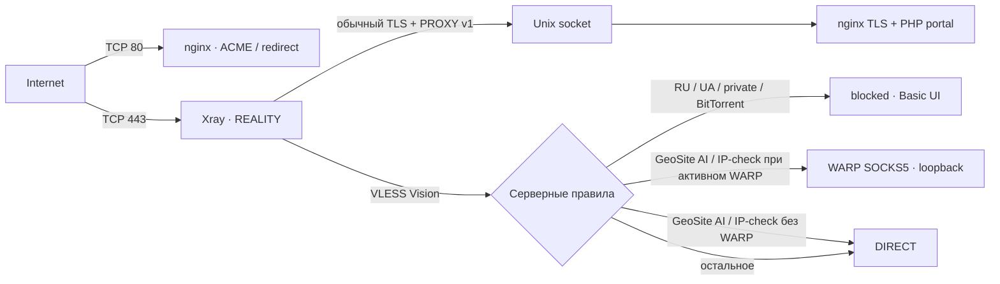

> VPS-Server-Menu v0.3.8: только актуальная официальная `Diman6267/VPS-Server-Menu/main`, разрешённая при установке. Статического menu pin больше нет. Оригинальный installer создаёт команды; main tracking origin/main сохраняет штатный updater (пункт 9). Фактическая ревизия и время находятся в root-only state `menu_revision`. Dirty/diverged/неизвестный checkout отклоняется без reset/clean; старый detached checkout автоматически не мигрирует. Xray/3x-ui/GeoData/routing pins не изменены. Будущая main может оказаться несовместимой: Bob прекращает установку, не откатываясь скрыто к старому pin.

<p align="center"></p>

<p align="center">
  <a href="https://github.com/DaMistic727/Bob-auto-xray/actions/workflows/ci.yml"></a>
  <a href="https://github.com/DaMistic727/Bob-auto-xray/releases"></a>
  <a href="LICENSE"></a>
  
</p>

# Bob Auto Xray

**Чистая VPS → готовый VLESS TCP REALITY Vision с собственным SNI.**

Одноразовый установщик разворачивает 3x-ui, HTTPS-заглушку частного облака и подписки для Happ/INCY. Cloudflare WARP выбирается отдельно; без него AI/IP-check идёт через обычный DIRECT. Конфигурации и первый VPN-клиент `admin` создаются автоматически; его подключение и подписку можно получить в панели. Дополнительных клиентов вы добавляете через 3x-ui.

> **v0.3.8 Preview.** Подписки Happ/INCY доступны на общем HTTPS/443 без отдельного публичного порта. Внутренние web/subscription servers используют loopback HTTPS. Сохранены `vless by bob`, постоянный `admin` и GeoSite ads block. Установленные старые ноды не мигрируют автоматически. VPS E2E и reboot этой сборки NOT TESTED.

## Что получится

| Компонент | Результат |
|---|---|
| **3x-ui** | HTTPS/443 через Self-SNI Nginx, секретный путь 48 hex, уникальные credentials |
| **REALITY** | TCP/443, Self-SNI, Vision, Unix socket nginx, PROXY protocol v1 |
| **Заглушка** | Уникальный облачный login portal, PHP-FPM, CSRF; данные формы не сохраняются |
| **TLS** | Certbot HTTP-01 webroot, автоматическое продление для всех TLS-сервисов |
| **WARP** | По выбору: новый, существующий или отключён; при активном WARP SOCKS5 только на loopback |
| **VPN-клиент** | `admin` в `vless by bob`, Vision, случайный UUID/subId, без лимитов |
| **Маршрутизация** | Basic UI `blocked`, RU/UA/private/BitTorrent и категории рекламы GeoSite блокируются; `IPOnDemand`, остальное DIRECT |
| **Geodata** | Штатный Xray hot reload четырёх файлов ежедневно в 03:00 МСК через `direct`, с rollback |
| **TCP BBR** | Автоматически настраивается на поддерживаемом ядре Linux, с FQ pacing и сохранением после reboot |
| **IPv4-only** | Настраиваются проектные sysctl и networkd drop-in; известный P1: после reboot на `ens3` может возвращаться IPv6 link-local. Требуются SSH по IPv4 и FQDN без AAAA; production readiness заблокирована |
| **Happ / INCY** | Отдельные профили и способы доставки; правила из [DigneZzZ/routing](https://github.com/DigneZzZ/routing) |
| **Защита** | UFW с сохранением SSH, штатная интеграция Fail2ban 3x-ui |

Панель новых установок: `https://<domain>/<48-hex-secret>/`, без отдельного публичного административного порта. 3x-ui использует HTTPS на `127.0.0.1:<random_internal_port>`; внутренние API Bob сохраняют TLS-проверку домена через `LocalTLS`. На `/` остаётся заглушка, остальные неизвестные пути возвращают 404. Подписки новых установок доступны через секретный путь на HTTPS/443; внутренний порт не публикуется.

UFW открывает SSH, 80 и 443; порт панели не открывается. Передача реального IP идёт через REALITY PROXY v1, доверенный Unix socket и Nginx, который заменяет входящие IP-заголовки. Панель доверяет только `127.0.0.1/32`. Секретный путь дополняет штатную авторизацию и CSRF. Ограничение POST login: 6/мин на IP, burst 5; обычные API этим лимитом не ограничены. [Архитектура, ограничения и миграция](docs/PANEL-HTTPS.md).

Внешний probe различает PASS, FAIL и INCONCLUSIVE: TCP connect и неуспешный TLS не доказывают доступность или закрытость панели. До первого старта проверяются сохранённые настройки TLS, loopback, port и webBasePath. [Архитектура панели](docs/PANEL-HTTPS.md), [история PR #12](docs/PANEL-HTTPS-REPORT.md).

## Быстрый старт

1. **Создайте DNS A-запись** своего FQDN на IPv4 VPS, без CDN proxy. Если IPv6 не настроен, удалите AAAA.
2. **Подготовьте чистую VPS** с root-доступом и открытыми у провайдера TCP/80 и TCP/443. Проверенная ОС — Ubuntu 26.04 amd64; установщик использует официальный WARP-пакет именно для codename VPS.
3. **Запустите установщик одной командой** от root:

   ```bash
   bash <(curl --fail --silent --show-error --location --proto '=https' --proto-redir '=https' https://github.com/DaMistic727/Bob-auto-xray/releases/download/v0.3.8/install.sh)
   ```

   v0.3.8 запускает мастер с вопросами о домене и сертификате, показывает живой статус длительных операций и объясняет ошибки Certbot. Bootstrap загружает **конкретный релиз** и проверяет закреплённый SHA256 архива до выполнения модулей.

4. **Сохраните HTTPS-ссылку, логин и пароль**, которые появятся после успешных проверок. На VPS результат хранится в root-only `/var/lib/selfsni/state.json`.
5. **Откройте `vless by bob` в 3x-ui:** VPN-клиент `admin` уже создан с Vision, без лимита IP/устройств/трафика и срока действия. Получите его подключение или подписку. Дополнительных клиентов можно добавить через панель. Учётная запись панели имеет отдельные случайные username/password.

<details>
<summary>Выбор WARP и запуск без вопросов</summary>

Скопируйте и распакуйте проверенный release archive, затем:

```bash
bash /root/selfsni/install.sh --domain vpn.example.com --adopt-warp
bash /root/selfsni/install.sh --domain vpn.example.com --no-warp
bash /root/selfsni/install.sh --domain vpn.example.com
```

Без флагов выбирается новый WARP. `--adopt-warp` устанавливает или проверяет совместимое официальное меню, затем вызывает только read-only `server-menu warp health --port 40000 --json` и требует active/Connected, proxy mode, loopback SOCKS5 и реальный `warp=on`; несовместимый WARP не меняется. `--no-warp` не устанавливает и не проверяет WARP, не создаёт его outbound и не меняет уже установленный сторонний WARP. Оба флага взаимоисключающие. В мастере доступны те же три пункта.

Параметры: `--domain`, `--email`, `--ssh-port`, `--adopt-warp`, `--no-warp`, `--preflight-only`. При non-interactive запуске `--domain` обязателен. `NO_COLOR=1` отключает ANSI-цвета. `--preflight-only` строго read-only.

v0.3.7 хранит этап, installation ID и режим WARP в root-only state. После доказанного сбоя `APT_UPDATE`, `APT_UPGRADE`, `APT_INSTALL`, `WARP` или выдачи сертификата повтор продолжает установку, сохраняя режим, порты и credentials. Сменить режим при resume нельзя. Если домен уже сохранён, мастер не спрашивает его снова. Перед повтором Certbot заново проверяются WARP через официальный health API в режимах install/adopt и HTTP ownership. Узкий legacy-migration поддерживает только точный ранний `apt-get exited 100` из v0.3.3 при отсутствии любого управляемого пути; неизвестное старое состояние отклоняется. После более поздней стадии автоматическое продолжение запрещено. Полный redacted журнал команд находится в `/var/log/bob-auto-xray/install.log` с правами `0600`; одновременно работает только один установщик.

</details>

## Как устроен трафик



Клиентские профили Happ/INCY направляют российские и локальные ресурсы напрямую с устройства. Серверная RU-блокировка служит дополнительной защитой, если такой трафик всё-таки попадёт в туннель. Полный состав и приоритеты — в [описании архитектуры](docs/ARCHITECTURE.md).

## Поддержка и проверки

### Bob Doctor

На сервере, установленном этим кандидатом, диагностика запускается от root:

```bash
bob doctor
bob doctor --deep
bob doctor --json
bob doctor --deep --json
```

Для работы из исходников: `PYTHONPATH=src python3 -m selfsni.doctor --help`. Установщик сохраняет модуль в `/usr/local/lib/bob-auto-xray` и создаёт `/usr/local/bin/bob`, только если имя свободно. При занятом имени установка VPN продолжается, чужая команда не заменяется. Тогда Doctor запускается из сохранённого модуля: `/usr/bin/python3 -I -B -c 'import sys; sys.path.insert(0, "/usr/local/lib/bob-auto-xray"); from selfsni.doctor import main; raise SystemExit(main())' --json`.

На VPS, установленной прежним релизом, команда `bob` автоматически не появится. Для разового запуска используйте модуль из отдельно проверенного и распакованного release archive: `/usr/bin/python3 -I -B -c 'import sys; sys.path.insert(0, "/путь/к/архиву/selfsni/src"); from selfsni.doctor import main; raise SystemExit(main())' --json`. Архив должен быть доступен только root. Doctor читает подтверждённый state schema 2; неизвестная схема или незавершённая установка дают `UNKNOWN` без миграции.

Обычный режим читает state, runtime-конфигурацию Xray, GeoData, службы, listeners, локальный TLS-сертификат, BBR/FQ, фактические IPv6-интерфейсы, networkd/sysctl, SWAP и параметры защиты. Внешних сетевых запросов он не делает. Старые установки без управляемого IPv6 или SWAP получают `SKIP` при отсутствии соответствующих файлов; неисправный управляемый SWAP — `FAIL`, неподтверждённое стороннее состояние — `UNKNOWN`. `--deep` добавляет локальные HTTPS GET для fallback, панели и подписок, а также ограниченные по времени Cloudflare trace через WARP SOCKS5 и прямой egress. GET может создать запись в логе или PHP-сессию. Doctor не меняет клиентов, inbound, routing, geodata, firewall, WARP или state и не выполняет автоматическое исправление.

`HEALTHY` означает, что **проверенные локальные инварианты** выполнены; это не тест настоящего VPN-клиента из сети конкретного провайдера. `DEGRADED` означает предупреждение без подтверждённого критического отказа; `UNHEALTHY` — подтверждённый критический отказ; `UNKNOWN` — недостаточно данных или прав. Намеренно отключённый WARP получает `SKIP`. Коды выхода: `0`, `1`, `2`, `3` соответственно. `--json` печатает один объект со стабильными ID проверок, `schemaVersion`, `scope`, `overallStatus`, `summary`, `checks` и `timestamp`; FQDN, пути доступа и секреты в отчёт не включаются.

Doctor не запускает Certbot, не выполняет API save/update, не создаёт тестовых клиентов и не проверяет доступность из внешних сетей. При незавершённой установке он останавливается после проверки state. Подробный контракт: [TESTING.md](docs/TESTING.md).

Если Doctor сообщает `FAIL`, проверьте соответствующую службу, конфигурацию и журнал вручную до любых изменений; `UNKNOWN` означает, что факт работоспособности установить не удалось. Для production нужны внешний клиент и проверка после reboot: один `HEALTHY` не подтверждает доставку трафика у конкретного провайдера. План безопасного испытания: [DOCTOR-E2E.md](docs/DOCTOR-E2E.md).

| Платформа / сценарий | Статус |
|---|---|
| v0.3.6 | Локальные тесты, real Nginx и pinned 3x-ui API в CI; VPS clean install/reboot NOT TESTED |
| v0.3.5 · сообщение владельца | Установка, HTTPS/443, Reality Vision, Happ/INCY, WARP и routing проверены владельцем. Это не E2E v0.3.6 и не подтверждение IPv6 persistence |
| v0.3.4 · исторический официальный WARP на Ubuntu 26.04.1 amd64 | Smoke E2E #1: чистая установка, новая регистрация, Certbot, REALITY Vision и on-host 27/27. Позднее IPv6 отключение проверено на уже установленной VPS до/после reboot; отдельная чистая установка с этим изменением не проверена |
| v0.2.0 · Ubuntu 24.04 amd64 + существующий WARP | Проверены установка через `--adopt-warp`, внешний клиент и reboot |
| v0.3.1 · Ubuntu 26.04.1 amd64, чистая ОС | Проверены установка всех VPN-компонентов, Target UI, новая регистрация WARP, внешний клиент и reboot |
| v0.3.3 · кандидат PR #6 на Ubuntu 26.04.1 amd64 | Проверены clean install, новая WARP-регистрация, BBR/FQ и TCP socket, Target UI, 26/26 on-host и 7/7 external checks до/после reboot; опубликованный архив v0.3.3 отдельно не разворачивался |
| Ubuntu 22.04; arm64 | Предусмотрены в коде; отдельное развёртывание не проверено |
| Native Geodata Auto-Update | Проверены 4 assets, UTC→03:00 МСК, hot reload, ошибка, rollback и reboot |
| Happ / INCY contracts | Проверены реальные HTTP-ответы, Base64/JSON и deeplink |
| iOS Happ/INCY | **User-verified E2E: VPN connection, applied routing and WARP confirmed.** Физический iPhone, 18.10.2026 |
| Android | Пока не проверен |

CI выполняет статические проверки, unit/bootstrap-тесты и воспроизводимую сборку. Он **не заменяет** развёртывание на VPS. Подробные подтверждения: [тестирование](docs/TESTING.md), [v0.3.2 clean install + BBR + reboot](docs/reference-v032-e2e.json), [REALITY Target API/DB/editor/runtime](docs/reference-target-acceptance.json), [обезличенный API/runtime snapshot](docs/reference-config-redacted.json), [native geodata E2E](docs/reference-geodata-acceptance.json), [on-host E2E](docs/reference-onhost-acceptance.json), [внешний клиент](docs/reference-external-acceptance.json). Ранние результаты Ubuntu 24.04 сохранены отдельно в [истории](docs/history/README.md).

## Документация и участие

- [Архитектура, маршрутизация и безопасность](docs/ARCHITECTURE.md)
- [Релизы, SHA256 и установка из исходников](docs/RELEASE.md)
- [Версии и контрольные суммы upstream](versions.lock.json)
- [Изменения](CHANGELOG.md) · [Планы](docs/ROADMAP.md)
- [Как предложить изменение](CONTRIBUTING.md) · [Сообщить об уязвимости](SECURITY.md)

Проект использует официальные [3x-ui](https://github.com/MHSanaei/3x-ui), [VPS-Server-Menu](https://github.com/Diman6267/VPS-Server-Menu) и [DigneZzZ/routing](https://github.com/DigneZzZ/routing). [Атрибуция и лицензии зависимостей →](THIRD_PARTY_NOTICES.md)

Код проекта распространяется под [GPL-3.0](LICENSE). Данные и материалы третьих сторон сохраняют условия своих правообладателей.

Глобальная блокировка рекламы использует серверный `geosite:category-ads-all` и сохраняет RU-категорию. Она ограничена покрытием GeoSite; профили Happ/INCY не изменены. Старые завершённые установки автоматически не мигрируют. [Три изменения и проверки v0.3.6](docs/V036-VALIDATION.md).
