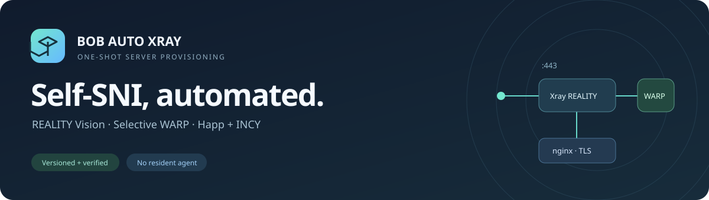

<p align="center">
  
</p>

<p align="center">
  <a href="https://github.com/DaMistic727/Bob-auto-xray/actions/workflows/ci.yml"></a>
  <a href="https://github.com/DaMistic727/Bob-auto-xray/releases"></a>
  <a href="LICENSE"></a>
</p>

# Bob Auto Xray

**VLESS TCP REALITY + Vision + Self-SNI — проверенные практики настройки для российских сетей. Одна команда вместо ручной конфигурации.**

Bob разворачивает на чистой VPS Xray, панель 3x-ui, HTTPS, маршрутизацию и защиту.

> **v0.4.2 · Preview** · Основная платформа: **Ubuntu 26.04.1 amd64** (VPS E2E v0.4.0; v0.4.2 на VPS не проверен) · [Статус тестирования](docs/TESTING.md)

## Что настраивается автоматически

- **VLESS TCP REALITY + Vision + Self-SNI.** Собственный домен, HTTPS-заглушка и REALITY на общем TCP/443.
- **Маршрутизация для российских сетей.** В готовых профилях Happ/INCY российские ресурсы идут DIRECT с устройства. Попавшие в туннель RU/UA/private-направления, BitTorrent и рекламные категории блокируются серверными правилами; блокировка рекламы ограничена покрытием GeoSite.
- **Защищённая 3x-ui.** Панель и подписки доступны через HTTPS/443 по отдельным секретным путям. Внутренние порты слушают только loopback. Для панели секретный путь дополняет TLS и вход по логину/паролю.
- **Cloudflare WARP по выбору.** Сервер направляет категории GeoSite AI/IP-check через WARP, если трафик попал в туннель и не заблокирован более ранними правилами. Можно установить WARP, использовать совместимый существующий или пропустить; без WARP эти запросы идут через серверный DIRECT.
- **Готовые Happ / INCY.** Профили маршрутизации, HTTPS-подписки и постоянный клиент `admin` создаются при установке.

Дополнительно Bob настраивает **Let's Encrypt, UFW, Fail2ban, TCP BBR**, политику IPv4-only и автоматическое обновление GeoData. Для проверки состояния сервера предусмотрен **Bob Doctor**.

## Установка

**1. Подготовьте VPS и домен.** Нужны чистая Ubuntu 26.04 amd64, доступ `root` по IPv4, публичный IPv4 и открытые входящие TCP-порты SSH, 80 и 443. Создайте DNS **A-запись**: `vpn.example.com → IPv4 вашего VPS`. В Cloudflare выберите **DNS only**, без проксирования; у других DNS-провайдеров также отключите CDN proxy. **Удалите AAAA-запись**: установщик требует IPv4-only. Дождитесь завершения первоначальной настройки ОС (cloud-init).

**2. Подключитесь по SSH и запустите установщик:**

```bash
bash <(curl --fail --silent --show-error --location --proto '=https' --proto-redir '=https' https://github.com/DaMistic727/Bob-auto-xray/releases/download/v0.4.2/install.sh)
```

Мастер запросит необходимые параметры и выполнит настройку. Используется bootstrap конкретного релиза с проверкой SHA256 архива.

**3. Получите подключение.** После установки откройте выданную HTTPS-ссылку панели и войдите с созданными учётными данными. В `vless by bob` уже есть клиент `admin`: его ссылку подключения или подписку можно использовать в Happ/INCY. Новых клиентов можно добавлять через 3x-ui.

## Управление

На новых установках, если имя команды свободно, от `root` выполните `bob` — откроется меню доступа к панели, подписки `admin`, диагностики и состояния установки.

```bash
bob                 # меню
bob doctor          # локальная диагностика без изменений
bob doctor --deep   # расширенные сетевые проверки
```

Меню и Doctor работают только на чтение. Обновление CLI на старой ноде, команды без меню и коды выхода — в [руководстве по эксплуатации](docs/OPERATIONS.md).

Исходные данные доступа хранятся в защищённом состоянии установки; их просмотр требует прав `root`. Если пароль панели изменён вручную, сохранённый исходный пароль может быть неактуален.

## Важно знать

Bob рассчитан на **новую чистую VPS**. Завершённые установки старых версий не мигрируют автоматически. Статус **Preview** означает неполное покрытие VPS E2E: Ubuntu 22.04/24.04 и arm64 предусмотрены кодом, но не подтверждены для текущего релиза; режимы WARP и клиентские платформы имеют отдельные ограничения в статусе тестирования. Ни REALITY, ни Self-SNI не гарантируют работу в любой сети или устойчивость к любым ограничениям DPI.

## Документация

[Архитектура](docs/ARCHITECTURE.md) · [Эксплуатация](docs/OPERATIONS.md) · [Релизы](docs/RELEASE.md) · [Тестирование](docs/TESTING.md) · [История изменений](CHANGELOG.md)

[Безопасность](SECURITY.md) · [Участие в проекте](CONTRIBUTING.md) · [Планы](docs/ROADMAP.md)

Проект использует [Xray-core](https://github.com/XTLS/Xray-core), [3x-ui](https://github.com/MHSanaei/3x-ui), [VPS-Server-Menu](https://github.com/Diman6267/VPS-Server-Menu) и [DigneZzZ/routing](https://github.com/DigneZzZ/routing). [Лицензия GPL-3.0](LICENSE) · [Уведомления о сторонних компонентах](THIRD_PARTY_NOTICES.md).
