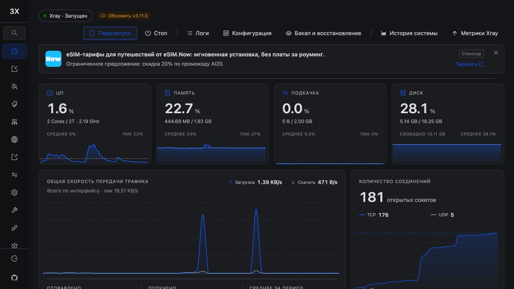
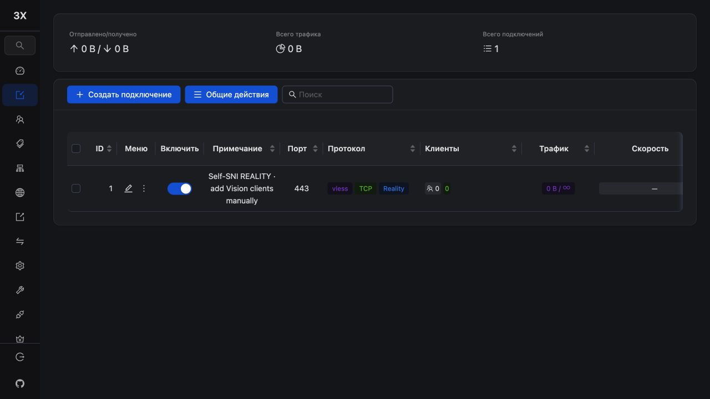

# Отчёт: 3x-ui через HTTPS/443

Дата: 29 октября 2026, Europe/Moscow. Ветка: `codex/panel-https-443`.
База: `origin/main`, `a4a8074e9825fc89931f343861b346f872966857`.
Исходный рабочий каталог с незавершённым Bob Doctor не изменён.
Изменения локальные: push, PR, merge и публикация release не выполнялись.
Production VPS не менялась; установка и reboot выполнены только на отдельно
подтверждённой пользователем одноразовой Ubuntu 26.04.1 amd64.

## Результат и архитектура

Панель работает через `https://<domain>/<48-hex-secret>/`, без случайного порта
в публичном URL. Xray остаётся единственным владельцем TCP/443; REALITY target
`/run/selfsni/nginx.sock`, `xver=1`, Vision, Firefox и маршрутизация сохранены.
Nginx принимает TLS+PROXY v1 на прежнем Unix socket и отправляет только секретный
префикс на HTTPS `127.0.0.1:<internal_port>`. Upstream сертификат проверяется
с доменным SNI и системным CA bundle. Корень/decoy PHP-FPM/CSS/SVG сохранены.
Подписки сохранили старые порт, URL, формат и Happ/INCY contracts.

Реальный внешний браузер после reboot выполнил login, загрузил dashboard и
список inbound, сохранил существующий inbound штатным UI, затем выполнил logout.
После logout запрос защищённой страницы вернул форму входа. После UI save
независимый API-пробник подтвердил target/xver и публичный HTTP 200. Ошибок
browser console в проверенном журнале — 0. Секретный URL и credentials
не включены в этот отчёт или картинки.

## Изменённые файлы и причины

| Файл | Назначение |
|---|---|
| `templates/nginx-tls.conf` | Точный секретный prefix, login rate limit, relative slash redirect, прежний Unix listener, защита журналов |
| `templates/nginx-panel.conf` | Общий HTTPS proxy: полный URI, TLS verify/SNI, Host/IP headers, WS, timeout, 64 MiB body cap, privacy headers |
| `templates/nginx-http.conf` | Выключение URI/Referer logging также для HTTP redirect/ACME server |
| `src/selfsni/provision.py` | UFW без panel allow, loopback settings, root-only proxy config, bootstrap gate до первого старта, ExecStartPre binding |
| `src/selfsni/api.py` | Явное разделение public URL/port и прежнего internal LocalTLS; legacy state не мигрирует |
| `src/selfsni/ui.py` | Публичный URL без внутреннего порта для новой схемы |
| `src/selfsni/acceptance.py` | Четыре новые реальные проверки публичной панели и сохранённого binding |
| `src/selfsni/panel_checks.py` | Сеть/ownership/UFW, routes/assets, login, negative auth, CSRF, cookie, API >8 KiB, настоящий WS frame, logout |
| `src/selfsni/swap.py`, `tests/test_swap.py` | Узкое исправление доказанного Ubuntu 26.04 swapon-блокера, без изменения политики SWAP |
| `tests/test_panel_proxy.py` | 9 регрессий API/public URL, UFW и безопасного bootstrap |
| `tests/test_panel_checks.py` | 6 регрессий самих probes, включая PWA и WS ошибки первого прогона |
| `tools/test_panel_proxy.py` | 7 групп интеграционных проверок с настоящим Nginx, TLS upstream и негативными сертификатами |
| `tools/external_acceptance.py`, `tools/remote_fixture.py` | Новый public URL и marker в опциональном внешнем harness; проверка отсутствия внешнего panel TCP |
| `README.md`, `docs/ARCHITECTURE.md`, `docs/TESTING.md` | Новая схема, firewall и точные инструкции проверки |
| `docs/PANEL-HTTPS.md` | Исследование pinned upstream, threat model, startup, совместимость и ограничения миграции |
| Этот отчёт, `docs/panel-https-evidence.json`, две PNG | Проверяемые результаты, безопасные числовые доказательства и скриншоты |

Версии, `routing.py`, `core.py`, vendor, install-state schema и WARP реализация
не менялись. Новых зависимостей или постоянных служб нет.

## Выявленные проблемы и решения

1. Исходный bootstrap запускал панель до настройки TLS, затем сохранял
   `webListen=0.0.0.0` и открывал порт через UFW. Теперь root-only systemd gate
   не допускает старта до готовности loopback/TLS и проверенного Xray.
   Перед каждым последующим стартом CLI повторно применяет `127.0.0.1`.
2. Глобальный Nginx body cap 8k ломал бы операции панели. Только proxy locations
   получили 64m; штатный upstream ограничивает обычные мутации 10 MiB.
   DB backup/restore большего размера требует отдельного решения.
3. Обычный error log Nginx способен записывать secret URI/Referer. HTTP/TLS
   servers теперь не пишут access logs и направляют error logs в /dev/null.
   Цена — меньше runtime-диагностики; syntax/systemd/acceptance сохранены.
4. Первый реальный installer остановился до BBR/IPv6/панели: Ubuntu 26.04
   отвергла `swapon --output=NAME`. Исправлено на `--show=NAME --noheadings --raw`.
   Исходный failed-state сохранён на VPS. Проверено отсутствие частичных
   BBR/IPv6/SWAP/panel изменений; остановлен только stock Nginx, запущенный APT;
   полный preflight проверил границу APT_INSTALL перед ручным восстановлением
   этой стадии и штатным продолжением. Это **resumed installation**, а не
   доказательство clean first-run финального кандидата.
5. Первый новый acceptance ошибочно требовал `/assets/` также от штатного
   `pwa-register.js` и отправлял 17-byte WS key. Исправлены probes и добавлены
   отдельные регрессии. Работоспособность proxy подтверждена настоящим UI.
6. Непосредственно после `systemctl restart` первые три API checks попали в
   startup window: 29/32. После ожидания HTTPS readiness — 32/32. Vision и все
   GeoData сценарии того прогона завершились, временный клиент и расписание
   были восстановлены. Процедура проверки теперь явно требует readiness.
7. После reboot сохранился известный инфраструктурный дефект IPv6:
   `all/default.disable_ipv6=1`, но `ens3.disable_ipv6=0` и link-local IPv6.
   Networkd использует ожидаемый `10-netplan-ens3.network`; project drop-in
   `LinkLocalAddressing=no`, `IPv6AcceptRA=no` присутствует. Корень проблемы
   порядка применения networkd/sysctl в этом изменении не исправлялся.
   Общий post-reboot acceptance остаётся 31/32, статус готовности заблокирован.

## Результаты тестов

| Проверка | Результат | Доказательство / граница |
|---|---|---|
| Unit/regression Python 3.12 | PASS | 136/136, включая существующие WARP/state/SWAP/REALITY тесты |
| Unit/regression Python 3.14 | PASS | 136/136 |
| Python 3.10 CI matrix | NOT TESTED | Runtime локально отсутствует; remote CI не запускался |
| ShellCheck, Bash syntax, compileall, diff check | PASS | Локальные CI-equivalent проверки |
| Два воспроизводимых локальных release build + checksum | PASS | Assets не публиковались |
| Реальный изолированный Nginx harness | PASS | 7/7 групп, повторён на финальной proxy-конфигурации |
| Неверный upstream hostname / недоверенный CA | PASS | В обоих случаях 502; verify не отключался |
| IP spoofing / exact prefix / login 429 / body >8k / WS frame | PASS | Настоящий Nginx + HTTPS test upstream |
| On-host acceptance до reboot, после readiness | PASS | 32/32 |
| Публичный login, неверный пароль, CSRF, cookie, API и WS | PASS | Реальный HTTP/TLS через Xray/443 и Nginx |
| Реальный внешний браузер | PASS | Login, dashboard/assets, inbound UI save, reload, logout, protected-page redirect |
| Loopback binding / UFW / единственный Xray TCP/443 | PASS | До/после reboot; панель только 127.0.0.1, allow rule отсутствует в IPv4/IPv6 UFW |
| Внешняя доступность внутреннего HTTPS | PASS | TLS handshake недоступен; сервер получил 3 SYN и не выдал ни одного SYN-ACK. macOS connect() при этом вернул успех — свидетельство промежуточного сетевого слоя, не handshake с VPS |
| REALITY target/xver после API save и браузерного UI save | PASS | Независимый API/DB/runtime check и браузерный редактор |
| On-host реальный Vision и Happ/INCY | PASS | Второй Xray-процесс, реальное соединение, subscriptions, routing, cleanup |
| Независимый внешний Vision с Mac | NOT TESTED | Пользователь выбрал оставить on-host результат; временный внешний клиент не создавался |
| GeoData download/hot reload/failure/rollback | PASS | Реальные upstream tick, HTTP error и invalid 200, восстановление файлов/cron |
| Certbot production certificate / renewal dry-run | PASS | Установщик получил сертификат и выполнил dry-run с deploy hook |
| Fail2ban sshd/3x-ipl | PASS | Реальные jails active; 3x-ipl не объявляется login jail |
| Restart Nginx / x-ui | PASS | Acceptance после readiness 32/32 |
| Reboot: панель, Nginx, Xray, sessions/API/WS, cert, SWAP | PASS | Все соответствующие проверки прошли; браузер проверен после reboot |
| Reboot: вся инфраструктурная приёмка | FAIL | 31/32, единственный FAIL — IPv6 ens3; см. evidence |
| WARP skip | PASS | Реальная установка без WARP и проверки отсутствия зависимости |
| WARP install/adopt на этой VPS | NOT TESTED | Код не изменён; не выдаём unit coverage за live E2E |
| Clean first-run окончательного кандидата | NOT TESTED | Текущая установка продолжена после раннего swapon-сбоя |
| Ubuntu 22.04/24.04, arm64 | NOT TESTED | Live проверка только Ubuntu 26.04.1 amd64 |
| DB import большого backup, многочасовой WS | NOT TESTED | Проверены лимит >8 KiB, handshake/frame и обычные операции |
| In-place production migration | NOT TESTED | Автоматическая миграция отсутствует и не выполнялась |

[Числовые доказательства](panel-https-evidence.json) содержат только фиксированные
поля, счётчики и булевы результаты; исходные root-only state и raw reports
не добавлялись в репозиторий.

## Security review и оставшиеся риски

Публичная поверхность административного интерфейса теперь находится на 443
в пределах секретного префикса. Это сохраняет штатную аутентификацию, CSRF,
случайные credentials и TLS, а прямой panel listener ограничен loopback.
Дополнительного публичного TLS listener или открытого proxy нет. Nginx
жёстко фиксирует upstream/Host/SNI и заменяет IP-заголовки данными доверенного
PROXY v1; штатный trustedProxyCIDRs панели ограничен 127.0.0.1/32.
Путь сохраняет 192 бита энтропии. Proxy config/state/DB/private keys root-only.

Издержки: общий NAT разделяет login budget; секретный путь остаётся в истории
авторизованного браузера; root/Nginx-компрометация вне модели угроз; отключённые
URI logs ограничивают диагностику. Stock 3x-ui logout очищает браузерную cookie,
но не отзывает ранее скопированную signed cookie на сервере. Jail 3x-ipl
реагирует на VPN IP-limit и может затронуть общий 443 при бане; он не защищает
panel login. Подробности и безопасная миграция — в PANEL-HTTPS.md.

Ранее существовавший reboot IPv6-блокер остаётся. Отдельный внешний Vision,
полностью чистая установка финального кандидата и другие платформы не проверены.
Test state на VPS сохраняет FAILED/ACCEPTANCE от первого acceptance, вместе
с позднейшими отдельными успешными отчётами и исходным failed-state; успешный
installer first-run или HEALTHY_LOCAL задним числом не имитировались.

## Готовность

Реализация готова к повторному E2E на новой одноразовой VPS. На текущей VPS
подтверждена основная HTTPS/443 архитектура и реальные браузерные сценарии,
но весь набор критериев готовности ещё не выполнен. Production readiness,
merge, release и развёртывание на действующих нодах не заявляются.
